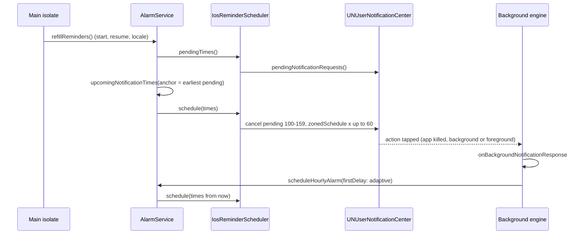

# 000022 - iOS Recurring Reminders: Completion Report

## Summary

iOS now schedules recurring reminders as a rolling window of up to 60 one-shot notifications. Notification actions ("Отложить", "Я уже подвигался") are handled in the background engine. Reaction time and the adaptive interval work on iOS. Turning on a day off no longer cancels the reminder chain on either platform.

All 4 batches of [000022-ios-recurring-reminders.md](000022-ios-recurring-reminders.md) are implemented.

## How it works

## Changes Made

### Batch 1: Background action handling

- `ios/Runner/AppDelegate.swift`: sets `UNUserNotificationCenter.current().delegate`, registers `FlutterLocalNotificationsPlugin.setPluginRegistrantCallback` in `didInitializeImplicitFlutterEngine`.
- `lib/services/notification_service.dart`: top-level `onBackgroundNotificationResponse` (`@pragma('vm:entry-point')`). It calls `DartPluginRegistrant.ensureInitialized()`, reloads `SharedPreferences`, runs `NotificationService.initialize(requestPermissions: false)` and then the shared `handleResponse`. `initialize()` now takes a `requestPermissions` flag, so both engines register the same categories.

### Batch 2: Rolling-window scheduler

- `lib/services/alarm_service.dart`:
  - pure `upcomingNotificationTimes()` built on the unchanged `nextNotificationTime()`;
  - `scheduleHourlyAlarm({Duration? firstDelay})` and `cancelAlarm()` have iOS branches (`Platform.isIOS`);
  - new `refillReminders()` (iOS refill from the earliest pending reminder, Android no-op);
  - iOS operations run one after another through a static future chain.
- `lib/services/ios_reminder_scheduler.dart` (new): owns the id range 100-159, the cap of 60, the payload format and `DarwinNotificationDetails`.
- `lib/services/notification_l10n.dart` (new): `resolveNotificationLocalizations()`, moved out of `NotificationService`.
- `lib/main.dart`: refill on start, on `AppLifecycleState.resumed`, and after a language change.
- `lib/screens/settings_screen.dart`: refill after a work day is toggled.

### Batch 3: Reaction time, adaptive interval, snooze payload

- The "Я уже подвигался" handler writes the scheduled time from the payload to `movement_last_notification_sent_millis` before `MovementActionHandler.handle()`.
- `MovementActionHandler` passes the adaptive interval as `firstDelay`.
- Snooze and the test notification carry their time in the payload.

### Batch 4: Day off

- `home_screen.dart` and `settings_screen.dart`: turning on a day off calls `scheduleHourlyAlarm()` instead of `cancelAlarm()` (when reminders are enabled).

## Deviations from the plan

1. **`cancel()` removes only pending reminders**, found through `pendingNotificationRequests()`. The plan said "cancel ids 100-159". Cancelling by id on iOS also removes delivered notifications from Notification Center, so a refill on app open would have wiped a reminder the user had not acted on yet.
2. **`_toggleReminders` in `home_screen.dart` now saves preferences before scheduling.** It used to schedule first and save after. The iOS scheduler reads `is_enabled` from storage, so turning reminders on would have cancelled the queue right away. On Android the order doesn't matter.
3. **iOS queue operations are serialized** (static future chain in `AlarmService`). Start-up refill, resume refill and a settings reset can overlap; without the chain their cancel and schedule steps could interleave.
4. **`AppDelegate` uses `delegate = self`** instead of the README's `self as? UNUserNotificationCenterDelegate`. The Swift compiler warned that the cast always succeeds.
5. **Refill uses a separate `anchor` parameter**, not `firstDelay = anchor - now` as the plan said. The anchor is dropped when an earlier day became available: for example, Saturday switched on on Friday evening while the earliest pending reminder is on Monday. With `firstDelay` the Saturday reminders would have been skipped.
6. **Toggling a work day triggers a refill.** The plan listed "days changed" as a reset, but `_toggleWorkDay` never rescheduled (Android reads work days when the alarm fires, so it didn't need to). On iOS, reminders already scheduled for a day that was switched off would still fire. Refill is a no-op on Android, so Android behaviour is unchanged.
7. **`ios/Podfile.lock` was updated** by `pod install` (run by `flutter build ios`). The committed lock was out of date: it lacked `url_launcher_ios` (already in `pubspec.yaml`) and had an old checksum for `flutter_local_notifications`.

## Additional finding

The plugin source (`FlutterLocalNotificationsPlugin.m`, `userNotificationCenter:didReceiveNotificationResponse:`) sends every action without the foreground option to the background engine, even when the app is in the foreground. So before this change the iOS action buttons did nothing in **any** app state, not only when the app was in the background. The old action branches in `onDidReceiveNotificationResponse` could never be reached.

## Verification

| Check | Result |
|---|---|
| `flutter analyze` | No issues |
| `flutter test` | 106/106 pass (95 existing + 11 new) |
| New tests watched failing first | Yes (missing API, then 12 assertion failures against stubs; the earlier-day anchor rule failed before it was added) |
| `swiftc -typecheck` of `AppDelegate.swift` against the iOS simulator SDK, Flutter.framework and the plugin headers | Passes, no warnings |
| `flutter build ios` | **Not run.** Xcode 26.6 reports "iOS 26.5 is not installed". Installed simulator runtimes are 18.6, 26.1, 26.2 |
| Manual iOS testing (checklist in the plan) | **Not done** |
| Android build / device test | **Not done.** The Android changes are limited to the Dart call sites in Batch 4 and the save order in `_toggleReminders` |

New tests:
- `test/services/alarm_service_test.dart`, group `upcomingNotificationTimes`: 9 tests (full day, non-work days, day-off, limit, first delay inside / outside window, anchor keeps the series, anchor dropped for an earlier work day, anchor dropped on a disabled day). 4 more tests from the plan's list were written and then removed as redundant: they repeated `nextNotificationTime` tests or passed without the code they were meant to check.
- `test/services/ios_reminder_scheduler_test.dart`: 2 tests for payload encoding and tolerant parsing.

## Remaining risks

- **Background engine behaviour is unverified on a device.** This covers `SharedPreferences`, `zonedSchedule` and `pendingNotificationRequests` inside the action engine. This is the main item for manual testing.
- The plugin calls `completionHandler()` right after starting the background engine and doesn't wait for Dart. iOS may suspend the app while the action is being handled. Since the follow-up below, the queue can no longer end up empty, but the movement event or the adaptive shift may still be lost. Covered by a manual check in the plan.
- If the main isolate and the background engine both write `movement_events` at the same moment (manual movement in the app + action tap), one write can overwrite the other. Same class of risk as on Android today.
- Action button labels are registered at `initialize()`. After a language change they update on the next app start or the next action tap (unchanged behaviour).

## Follow-up after review (2026-10-06)

| Change | Why |
|---|---|
| `IosReminderScheduler.schedule()` overwrites ids in place and cancels only leftover ids | The plugin calls `completionHandler()` without waiting for Dart, so iOS may suspend an action handler mid-rebuild. Cancel-then-add could leave the queue empty until the next app open. Now an interruption leaves the old queue partly updated, never empty |
| `schedule()` skips the rebuild when pending reminders already match (same ids, times, title, body) | A resume used to cost about 120 platform calls even when nothing changed. Title and body are compared too, so a language change still rebuilds. Limitation: once any reminder has fired since the last rebuild, the ids shift and the queue is rebuilt |
| `refillReminders()` catches and logs errors | It runs fire-and-forget on start and resume |
| `_setLocale` calls refill outside the persist `try` | The old "Failed to persist locale" log also covered refill errors |
| `dart format` | One line in `alarm_service.dart` exceeded 80 characters |

New tests in `test/services/ios_reminder_scheduler_test.dart` use an in-memory fake of `FlutterLocalNotificationsPlugin`. The first two failed against the old code:
- skips rebuild when the pending queue already matches;
- overwrites in place and cancels only leftover reminders;
- rebuilds when the notification text changed (guard);
- cancel keeps a pending snooze (guard).

Test suite after follow-up: 86/86 pass, `flutter analyze` clean, `dart format` clean.

## Rollback

Revert the change. Reminders already scheduled in ids 100-159 stay on users' devices and drain within days (see the coverage table in the plan). Batch 4 can be reverted on its own (two call sites).
