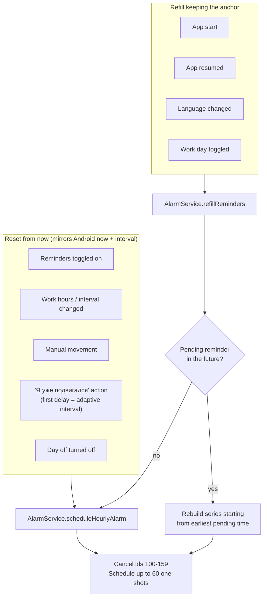

# 000022 - iOS Recurring Reminders

## Status: APPLIED (manual iOS testing pending)

All 4 batches implemented. Deviations from this plan are listed in [000022-ios-recurring-reminders-report.md](000022-ios-recurring-reminders-report.md).

## Background

The app claims iOS support, but on iOS only two notifications can ever appear: the "Test notification" button in Settings and the 10-minute snooze. Recurring reminders are never scheduled.

Evidence (code reading, not a device test):

- `AlarmService.scheduleHourlyAlarm()` and `cancelAlarm()` return early when not on Android (`lib/services/alarm_service.dart:8`, `:13`).
- The only `zonedSchedule` call is the iOS snooze (`lib/services/notification_service.dart:90`).
- `NotificationService.showHourlyNotification()` is only called from the test button (`lib/screens/settings_screen.dart:244`).
- `git log -S periodicallyShow` and `git log -S zonedSchedule` show no evidence of recurring iOS scheduling in the git history.

A second problem was found while reading the code. The iOS action buttons ("Отложить", "Я уже подвигался") are `DarwinNotificationAction.plain`, so they don't open the app. According to the `flutter_local_notifications` 21.0.0 README, such actions run in a separate background Flutter engine and are delivered to `onDidReceiveBackgroundNotificationResponse`. That callback is not registered, and `AppDelegate.swift` does not call `FlutterLocalNotificationsPlugin.setPluginRegistrantCallback`. So both buttons very likely do nothing when the app is in the background or killed.

### Core constraint

**iOS runs no app code when a local notification fires.** Android works around this with `AlarmManager` + `BroadcastReceiver`: each alarm runs Kotlin code that shows the notification and schedules the next one. On iOS there is no equivalent. Everything must be scheduled in advance, while the app (or a background action handler) is running.

Every design decision below follows from this.

## Design

### Rolling window of one-shot notifications

Each time scheduling runs, compute the next N reminder times and register each one as a one-shot `zonedSchedule` notification.

- **Cap: 60 notifications.** iOS keeps only the 64 most recently scheduled local notifications per app and silently drops the rest (plugin README). 60 leaves room for the snooze (id 2) and the test notification (id 1).
- **Dedicated id range: 100-159.** Cancel only this range, never `cancelAll()`, so a pending snooze survives a reschedule.
- **Payload = scheduled time in millis** (e.g. `"1791363600000"`). Used to compute reaction time and to find the anchor during refill.

Considered alternative: weekly repeating notifications (`matchDateTimeComponents: dayOfWeekAndTime`). They keep firing forever without opening the app. Rejected because:
- at a 15-min interval with default hours that's 36 slots/day x 5 days = 180, over the 64 limit;
- they can't skip a single day-off date without cancel and reschedule;
- they can't apply the adaptive shift after "Я уже подвигался".

### Known limitation: the queue runs out

If the user never opens the app and never taps a notification action, the queue is not refilled. Coverage with default hours (09:00-18:00, Mon-Fri):

| Interval | Reminders per work day | 60 slots last |
|---|---|---|
| 15 min | 36 | ~1.7 work days |
| 60 min | 9 | ~6.7 work days (~9 calendar days) |
| 120 min | 4 | 15 work days (~3 weeks) |

The queue is refilled on every app start, every resume, and every action tap ("Я уже подвигался", "Отложить"), so an active user should not hit this. Background App Refresh (`BGAppRefreshTask`) could help, but iOS gives no timing guarantees. Out of scope.

### Two scheduling operations

- **Reset** matches what Android does today: `ReminderScheduler` computes `now + interval`.
- **Refill** must not shift the series. If resume did a reset, opening the app at 10:20 would move the 11:00 reminder to 11:20. Android doesn't drift like this, so iOS must not either. The anchor is the earliest pending reminder time, read from payloads via `pendingNotificationRequests()`. Refill calls `upcomingNotificationTimes(now: now, firstDelay: anchor - now)`. This reuses the adaptive path: the anchor becomes the first element (it already passed the work-window checks when it was scheduled), and the rest of the series is computed from it. The series is deterministic from the anchor, so refill only extends it.
- Refill does nothing when reminders are disabled. On Android `refillReminders()` is a no-op, because the native chain keeps itself alive.

### Time zone

`tz.setLocalLocation()` is never called, so `tz.local` is UTC. Instead of adding `flutter_timezone` (new dependency), convert the local `DateTime` to an absolute instant: `tz.TZDateTime.from(localDateTime, tz.UTC)`.

This keeps the correct moment on iOS. Checked in the plugin source (`flutter_local_notifications-21.0.0/ios/.../FlutterLocalNotificationsPlugin.m`, `buildUserNotificationCalendarTrigger`): the date string is parsed with the passed `timeZoneName`, `calendar.timeZone` is set to it, and the non-repeating trigger components include `NSCalendarUnitTimeZone`. So a UTC time fires at the same instant as the equivalent local time. Still covered by a manual check below.

Side effect: times are fixed when scheduled. After a time zone change, the queue adjusts at the next refill or reset.

### Reaction time and adaptive interval

Android records `movement_last_notification_sent_millis` when the notification fires. iOS can't. Instead, the action handler reads the scheduled time from the payload and writes it to `movement_last_notification_sent_millis` before calling `MovementActionHandler.handle()`. Then `ConfirmMovementUseCase` computes the reaction time as it does today.

`MovementActionHandler` currently ignores the computed adaptive interval on iOS (see the comment in `movement_action_handler.dart`). With the new scheduler it passes it as `firstDelay`. This mirrors `AlreadyMovedReceiver.kt`:
- if `now + firstDelay` falls inside work hours on a work day that is not a day off, it becomes the first reminder, and the series continues from it with the base interval;
- otherwise, use the regular series from now.

## Batch 1: Background action handling (blocks everything else)

| File | Change |
|------|--------|
| `ios/Runner/AppDelegate.swift` | `import flutter_local_notifications`. In `didInitializeImplicitFlutterEngine` (the app already uses the UIScene variant with `FlutterImplicitEngineDelegate`), call `FlutterLocalNotificationsPlugin.setPluginRegistrantCallback { registry in GeneratedPluginRegistrant.register(with: registry) }`. In `didFinishLaunchingWithOptions`, set `UNUserNotificationCenter.current().delegate = self as? UNUserNotificationCenterDelegate` |
| `lib/services/notification_service.dart` | Add top-level `@pragma('vm:entry-point') Future<void> onBackgroundNotificationResponse(NotificationResponse)`. Register it as `onDidReceiveBackgroundNotificationResponse`. Both callbacks call one shared handler |

The background engine never runs `main()` or `NotificationService.initialize()`. The background handler must first:
1. call `DartPluginRegistrant.ensureInitialized()` (so `shared_preferences` works in the isolate);
2. call `tz_data.initializeTimeZones()`;
3. initialize the plugin with `DarwinInitializationSettings` that do **not** request permissions.

Build the init settings in one function with a `requestPermissions` flag, so both the main and the background engine register the same notification categories and action labels. (The plugin skips `setNotificationCategories` when the list is empty, so an empty list would not wipe the buttons, but one builder keeps the two paths from drifting.)

Body tap (`actionId == null`) still sets `tabNotifier` only in the main isolate.

**Verify on device:** this is the riskiest part. The plugin README describes the setup, but whether `SharedPreferences` and `zonedSchedule` work inside the background engine can only be confirmed on a real run.

## Batch 2: Rolling-window scheduler

| File | Change |
|------|--------|
| `lib/services/alarm_service.dart` | Add pure static `upcomingNotificationTimes({required DateTime now, ...same params as nextNotificationTime, String? dayOffDate, Duration? firstDelay, int limit = 60})`. Loops over the existing `nextNotificationTime()`, skips times on `dayOffDate`, applies `firstDelay` as described above. `nextNotificationTime()` itself is not changed |
| `lib/services/alarm_service.dart` | `scheduleHourlyAlarm({Duration? firstDelay})`: Android path unchanged (ignores `firstDelay`); iOS path does a reset. `cancelAlarm()`: iOS path cancels ids 100-159. New `refillReminders()`: iOS refill, Android no-op. Use `Platform.isIOS` explicitly, so tests on a macOS host don't touch the plugin |
| `lib/services/ios_reminder_scheduler.dart` (new) | Thin plugin wrapper: `schedule(List<DateTime>)`, `cancel()`, `pendingTimes()`. Owns the id range, payload format, `DarwinNotificationDetails`. Injected into `AlarmService` through the constructor with a default instance |
| `lib/services/notification_service.dart` | Make the localization resolver reusable by the new scheduler (move `_resolveLocalizationsFrom` to a shared helper) |
| `lib/main.dart` | After `NotificationService.initialize()`, call `alarmService.refillReminders()`. `_HourlyReminderAppState` observes the app lifecycle and calls `refillReminders()` on `resumed`. `_setLocale` calls `refillReminders()` (the notification text is fixed at scheduling time on iOS) |

Notification text: the same `notificationTitle` / `notificationBody` the current iOS path uses. On Android, gender only affects exercise text, and exercises are out of scope, so a gender change needs no refill.

Before the refill, call `prefs.reload()`: the background action engine may have written prefs that the main isolate's cache doesn't see.

## Batch 3: Reaction time, adaptive interval, snooze payload

| File | Change |
|------|--------|
| `lib/services/notification_service.dart` | Shared handler: for "Я уже подвигался", parse the payload into a `DateTime` (tolerant: `int.tryParse`, `null` on anything else) and save it with `setLastNotificationSentTime()` before `MovementActionHandler.handle()`. Snooze sets payload = its own scheduled time in millis. Test notification sets payload = now in millis |
| `lib/features/movement/presentation/movement_action_handler.dart` | `scheduleNext: (interval) => alarmService.scheduleHourlyAlarm(firstDelay: interval)`. Remove the outdated "iOS limitation" comment |

Manual movement in `home_screen.dart` keeps calling `scheduleHourlyAlarm()` without `firstDelay`. For manual movement `IntervalCalculator` returns the base interval anyway, so a reset from now gives the same result.

## Batch 4: Day off keeps the schedule alive (needs decision: touches Android)

Both `home_screen.dart` and `settings_screen.dart` call `alarmService.cancelAlarm()` when the user turns on "day off".

- **iOS (after Batches 1-3):** cancel wipes the queue. Tomorrow nothing fires until the app is opened and refill runs.
- **Android (today, found by reading the code, not tested):** `cancelAlarm()` cancels the alarm chain. `ReminderReceiver` reschedules only when an alarm fires, and nothing reschedules on app open. So after a day off, reminders stay off until the user changes a setting, logs a manual movement, or reboots the phone.

Fix: when day off is turned on, call `scheduleHourlyAlarm()` (if reminders are enabled) instead of `cancelAlarm()`.
- iOS: the reset skips today because `upcomingNotificationTimes` skips `dayOffDate`.
- Android: the chain stays alive. `ReminderReceiver` already returns early on the day-off date (after scheduling the next alarm), so today stays silent and tomorrow works.

| File | Change |
|------|--------|
| `lib/screens/home_screen.dart` | `_toggleDayOff`: replace `cancelAlarm()` with `scheduleHourlyAlarm()` when enabled |
| `lib/screens/settings_screen.dart` | Same change in `_toggleDayOff` |

Optional follow-up (not in this plan): teach `ReminderScheduler.nextValidAlarmTime()` to skip the day-off date, so Android doesn't wake up for silent alarms on the day off.

## Out of scope

- Exercise text in iOS notifications (Android-only today; needs a Dart copy of `ExerciseRepository` and a decision about rotation when scheduling ahead).
- Resetting the sedentary timer on swipe-dismiss on iOS (Android has `NotificationDismissReceiver`; iOS needs `customDismissAction`).
- Background App Refresh to refill the queue without opening the app.
- Opening the Stats tab when the app is launched from a killed state by a notification tap (`getNotificationAppLaunchDetails()`).
- "Next reminder" banner after an adaptive shift (it shows `nextNotificationTime()` from now, same as on Android today).

## Implementation Steps

1. Batch 1: AppDelegate + background handler + shared response handler.
2. Batch 2: `upcomingNotificationTimes` with tests, `IosReminderScheduler`, `AlarmService` iOS branches, refill on start/resume/locale.
3. Batch 3: payload parsing, reaction time, adaptive `firstDelay`.
4. Batch 4 (if approved): day-off call sites.
5. Update README and `.claude/context.md` (iOS scheduling model, limitations).

## Tests

### Unit (new)

`test/services/alarm_service_test.dart`, group `upcomingNotificationTimes`:
- [ ] Normal day: series from first slot to work end with the given interval
- [ ] Crosses midnight to the next work day
- [ ] Skips non-work days (Friday evening -> Monday)
- [ ] Skips the day-off date, continues on the next work day
- [ ] Respects `limit` (never more than 60)
- [ ] `firstDelay` inside the work window becomes the first time, the series continues from it
- [ ] `firstDelay` outside the work window falls back to the regular series
- [ ] Interval longer than the work window returns an empty list
- [ ] First element equals `nextNotificationTime()` for the same input (no `firstDelay`, today is not the day-off date)
- [ ] No drift: a series rebuilt with `firstDelay = series.first - now` equals the original series

Payload parsing helper:
- [ ] Millis string -> `DateTime`
- [ ] `null`, `"hourly_reminder"`, empty string -> `null`

All existing tests must pass unchanged.

### Manual (iOS simulator or device)

- [ ] Enable reminders, set interval 15 min: notifications arrive with the app killed
- [ ] A reminder planned for 10:00 local time fires at 10:00, not shifted by the UTC offset
- [ ] `pendingNotificationRequests()` shows at most 60 reminders in ids 100-159
- [ ] Open the app mid-series: the next reminder time doesn't shift
- [ ] "Я уже подвигался" with the app killed: event saved, next reminder after the adaptive interval
- [ ] "Я уже подвигался" with the app in background: same result
- [ ] "Отложить" with the app killed: notification after 10 min, regular series continues
- [ ] Changing interval/hours reschedules from now; snooze (id 2) survives
- [ ] Turn off a work day: no pending reminders left on that day
- [ ] Turn on a work day before the next pending one (e.g. Saturday on Friday evening): reminders appear on it
- [ ] Tap an action with the app killed, then check pending reminders: 60, not 0 and not a partial set (the plugin calls `completionHandler()` without waiting for Dart)
- [ ] Language change: next notifications use the new language
- [ ] Disable reminders: no reminder notifications remain pending
- [ ] Day off (if Batch 4): nothing today, reminders resume tomorrow without opening the app
- [ ] Android regression: reminders, snooze, "Я уже подвигался", day off still work

## Rollback Plan

Revert the commits. Note: notifications already scheduled in ids 100-159 stay registered on users' devices after a rollback, because the old code never cancels them on iOS. They drain within days (see the coverage table). If that matters, the rollback build should call `cancel` for ids 100-159 once at startup.

Batch 4 can be reverted separately (two call sites).

## Benefits and Estimated Time

- iOS users get the core feature of the app for the first time.
- iOS action buttons start working in the background.
- Adaptive interval and reaction time work on iOS the same way as on Android.
- With Batch 4: Android no longer loses reminders after a day off.

Estimated time: about 1 day of implementation and unit tests, plus 0.5 day of manual testing on a simulator or device. Batch 1 may take longer if the background engine needs extra setup.
